<!-- ===================================================== -->
<!--                    PROFILE BANNER                    -->
<!-- ===================================================== -->

  

<!-- ===================================================== -->
<!--                       INTRO                           -->
<!-- ===================================================== -->

<h1 align="center">Hi 👋, I'm Md. Najmul Hossain</h1>

<h3 align="center">
  Full-Stack Developer | Laravel · Next.js · NestJS · PostgreSQL
</h3>

  
  
  

  

---

<!-- ===================================================== -->
<!--                      ABOUT ME                         -->
<!-- ===================================================== -->

## 👨‍💻 About Me

I'm a Software Developer passionate about designing and developing scalable, efficient, and maintainable software solutions.

My primary focus is building business-oriented applications, including ERP, POS, Inventory Management, Accounting Systems, and SaaS platforms.

- 🔭 Building **ERP, POS & Business Management Applications**
- 💻 Working primarily with **PHP, Laravel & JavaScript**
- 🌱 Exploring **Next.js, NestJS, Prisma & PostgreSQL**
- 🏗️ Interested in **Software Architecture, API Design & Microservices**
- 🧪 Practicing **TDD, BDD & PHPUnit**
- ⚡ Focused on clean code, maintainability and performance.

---

<!-- ===================================================== -->
<!--                    TECH STACK                         -->
<!-- ===================================================== -->

## 🛠️ Tech Stack & Tools

### Frontend Development

  

### Backend Development

  

### Database & ORM

  

### Development Tools

  

---

<!-- ===================================================== -->
<!--                   WHAT I BUILD                        -->
<!-- ===================================================== -->

## 🚀 What I Build

<table>
  <tr>
    <td width="50%">
      <h3>🏢 Enterprise Applications</h3>
      ERP, Business Management and Enterprise Automation Systems.
    </td>
    <td width="50%">
      <h3>🛒 POS Solutions</h3>
      Point of Sale, Sales Management and Retail Applications.
    </td>
  </tr>
  <tr>
    <td width="50%">
      <h3>📦 Inventory Management</h3>
      Purchase, Stock, Warehouse and Product Management Systems.
    </td>
    <td width="50%">
      <h3>💰 Accounting Systems</h3>
      Financial Management, Ledgers and Business Accounting.
    </td>
  </tr>
  <tr>
    <td width="50%">
      <h3>🔌 Backend & APIs</h3>
      RESTful APIs, Database Design and Business Logic.
    </td>
    <td width="50%">
      <h3>☁️ SaaS Applications</h3>
      Scalable Web Applications and Business Automation.
    </td>
  </tr>
</table>

---

<!-- ===================================================== -->
<!--                  GITHUB ANALYTICS                     -->
<!-- ===================================================== -->

## 📊 GitHub Analytics

  
  

  

---

<!-- ===================================================== -->
<!--                   COLLABORATION                       -->
<!-- ===================================================== -->

## 🤝 Let's Collaborate

I'm open to collaborating on projects involving:

- ERP, POS & Inventory Management Systems
- Laravel & Next.js Applications
- RESTful API Development
- SaaS Platforms & Business Automation
- Open-source Projects
- Startup Ideas & Business Tools

---

<!-- ===================================================== -->
<!--                       CONTACT                         -->
<!-- ===================================================== -->

## 📫 Connect With Me

  
  
  

- 📧 **Email:** phpnajmul@gmail.com
- 💼 **LinkedIn:** [najmulbd](https://linkedin.com/in/najmulbd)
- 💻 **GitHub:** [phpnajmul](https://github.com/phpnajmul)

---

<!-- ===================================================== -->
<!--                       FOOTER                          -->
<!-- ===================================================== -->

  <b>Building Solutions. Empowering Businesses. 🚀</b>

  ⭐ If you find my work useful, consider starring my repositories!

